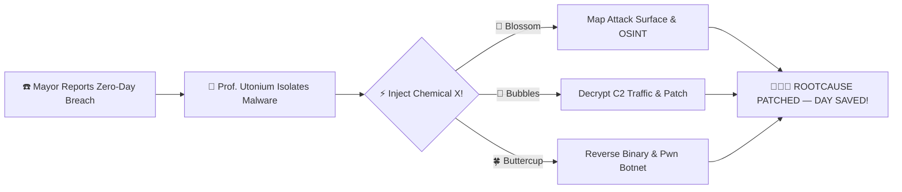

  <!-- ANIMATED POWERPUFF CYBER DEFENSE HERO BANNER (100% Self-Contained URL) -->
  

  <!-- Animated Typing Subtitle -->
  

  <!-- Powerpuff Cyber Security Ingredient Badges -->
  

    
    
    
    
  

  <!-- Live Townsville SOC Status Counters -->
  

    
    
    
    
  

<!-- Animated Neon Gradient Divider (Works Automatically Everywhere) -->

### 🛡️ The Ultra-Superpowered Cyber Defense Matrix

<table width="100%">
  <tr>
    <td width="33%" valign="top" align="center">
      
        
      

        <code>• Offensive Penetration Testing</code> 
        <code>• Ice-Breath Ransomware Freeze</code> 
        <code>• Adversary Emulation &amp; OSINT</code> 
        <code>• Web / API Vulnerability Hunting</code>
      

       
      
    </td>
    <td width="33%" valign="top" align="center">
      
        
      

        <code>• Speaks Assembly, Hex, C &amp; Python</code> 
        <code>• Deep Packet &amp; SIEM Forensics</code> 
        <code>• Zero-Trust Encryption Shields</code> 
        <code>• C2 Traffic Decryption &amp; Analysis</code>
      

       
      
    </td>
    <td width="33%" valign="top" align="center">
      
        
      

        <code>• Binary Exploitation &amp; Fuzzing</code> 
        <code>• Malware Dissection &amp; Rootkits</code> 
        <code>• Smashes Mojo Jojo Botnets</code> 
        <code>• Kernel &amp; Memory Corruption Pwn</code>
      

       
      
    </td>
  </tr>
</table>

 

<table>
  <tr>
    <td width="56%" valign="top">
      <h3>🧬 Security Log #0x01: Inside the Air-Gapped Lab</h3>
      
Greetings! I'm <b>Professor Utonium</b> (<code>@prof-utoniumm</code>) — Cyber Security Researcher, Vulnerability Hunter, and Chief Defender of the <b>City of Townsville's</b> critical infrastructure.

      <ul>
        <li>🌸 <b>Blossom Protocol (Red Team):</b> Tactical OSINT, Web/Network Penetration Testing, and freezing zero-day ransomware in its tracks.</li>
        <li>🫧 <b>Bubbles Protocol (Blue Team &amp; Crypto):</b> Fluent in every language from Python to x86_64 Assembly &amp; raw network pcaps; building bulletproof encryption &amp; SIEM detections.</li>
        <li>🍀 <b>Buttercup Protocol (Binary Pwn &amp; RE):</b> Dissecting obfuscated malware, fuzzing kernels, and smashing memory-corruption vulnerabilities.</li>
        <li>🐒 <b>Primary Threat Actor:</b> <i>APT-MOJO-JOJO</i> (Ransomware syndicates, SQLi/XSS gremlins &amp; unpatched CVEs).</li>
      </ul>
    </td>
    <td width="44%" valign="top">
      <h3>🧪 Live Chemical-X Payload Synthesis</h3>
      <pre lang="python">
def synthesize_cyber_defense():
    formula = [
        "🌸 Sugar (Stealth OSINT &amp; Recon)",
        "🫧 Spice (Zero-Trust Cryptography)",
        "🍀 Everything Nice (Memory-Safe Patch)"
    ]
    # OOPS! Accidental glass bump in the sandbox...
    chemical_x = "⚡ 0xDEAD_BEEF (0-Day Exploit PoC)"

    return {
        "researcher": "@prof-utoniumm",
        "clearance": "TOWNSVILLE-TOP-SECRET",
        "arsenal": formula + [chemical_x],
        "apt_neutralized": "Before Bedtime 🌙"
    }</pre>
    </td>
  </tr>
</table>

<!-- Animated Neon Gradient Divider -->

### 🧰 The Professor's Cyber Warfare & Forensics Arsenal

  <!-- Animated Skill Icons from skillicons.dev -->
  

    
  

  <!-- Specialized Offensive & Defensive Tool Badges -->
  

    
    
    
    
    
    
    
  

  | Security Domain | Lab Ingredients & Tooling | Superpowers Unlocked |
  | :--- | :--- | :--- |
  | 🌸 **Red Team & Recon** | `Kali Linux` · `Burp Suite` · `Nmap` · `Metasploit` · `OSINT` | Web/API exploitation, AD enumeration & adversary simulation |
  | 🫧 **Blue Team & Forensics** | `Wireshark` · `SIEM / Splunk` · `Cloudflare` · `YARA` · `Suricata` | Deep packet inspection, threat hunting & incident response |
  | 🍀 **Reverse Eng & Pwn** | `Ghidra` · `GDB / pwndbg` · `C / C++` · `Rust` · `x86_64 ASM` | Malware analysis, binary exploitation, ROP chains & fuzzing |
  | ⚡ **Chemical X Automation** | `Python` · `Go` · `Bash` · `PowerShell` · `Docker` | Custom exploit scripting, CTF automation & sandboxed detonation |

<!-- Animated Neon Gradient Divider -->

### 📊 Townsville SOC Mainframe & Threat Telemetry

  
  

  

  

<!-- Activity Graph in Powerpuff Colors -->

  

<!-- Animated Neon Gradient Divider -->

### 🚨 Townsville Incident Response & Zero-Day Kill Chain

  
<b>🕵️‍♂️ [CLASSIFIED // CLEARANCE LEVEL X] Click to Decrypt the Chemical X Threat Dossier</b>

   
  <blockquote>
    <b>⚠️ TOWNSVILLE CERT ADVISORY #0x99:</b> 
    <i>"If Threat Actor <code>APT-MOJO-JOJO</code> attempts privilege escalation or unauthorized root access, deploy Blossom, Bubbles, and Buttercup immediately. All payloads must be detonated inside an air-gapped Chemical X sandbox!"</i>
  </blockquote>
  <ul>
    <li>🏴 <b>CTF Flags Captured:</b> <code>root@townsville:~# cat flag.txt</code></li>
    <li>🦠 <b>Malware Samples Reversed:</b> <code>MojoCrypt.exe, HimWare.elf, FuzzyBot.bin</code></li>
    <li>🛡️ <b>Zero-Days Patched:</b> <code>100% Before Bedtime</code></li>
  </ul>

<!-- Animated Neon Gradient Divider -->

### ☎️ Ring the Townsville CERT Emergency Hotline

  *Zero-day vulnerability loose in your network? Need an ethical hacker or security audit infused with Chemical X? Pick up the encrypted hotline!*

  

    
    
    
  

   

  <h3>🎙️ <i>"And so once again, the network is secured and the day is saved — thanks to... <code>@prof-utoniumm</code>!"</i> 💖💙💚</h3>

  <!-- Animated Powerpuff Tri-Color Wave Footer -->
  

